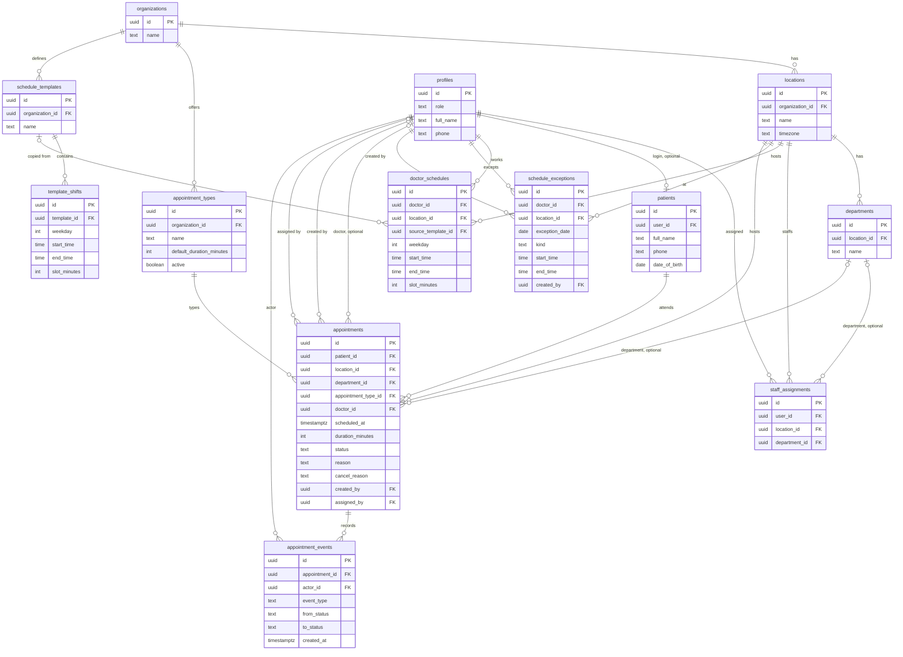
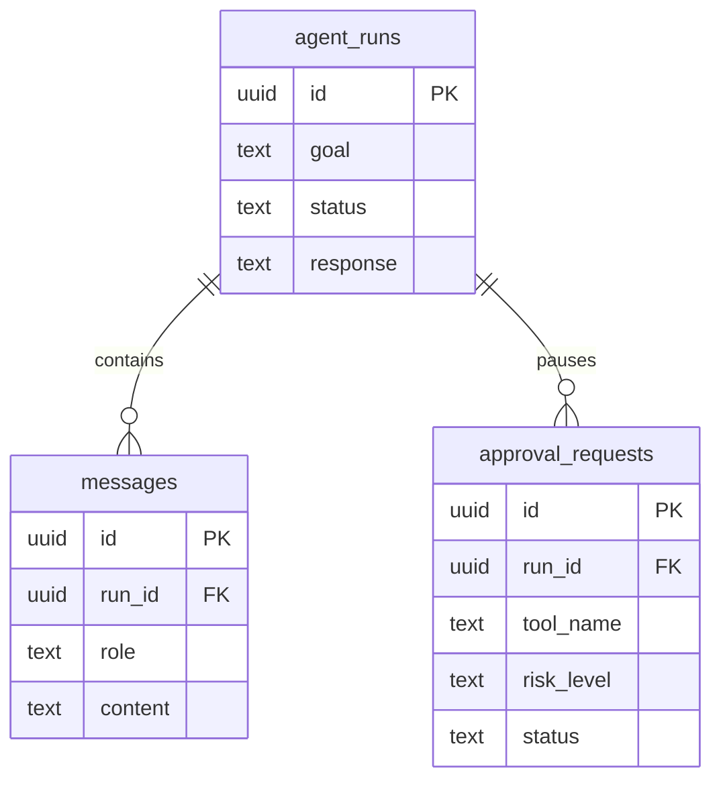

# AgentDesk Backend

Express API for AgentDesk. It verifies Supabase sessions, reads and writes clinic data with the Supabase service-role key, and runs the front-desk agent through Cohere.

The Expo app lives in the sibling `Frontend` folder. This service keeps `src/` at the top of `Backend`.

The HTTP contract for that app is [docs/API.md](docs/API.md). The clinic tables are [docs/DATA_MODEL.md](docs/DATA_MODEL.md).

## Layout

```
src/
  app.ts, server.ts
  config/            environment, Supabase, Cohere
  middleware/        authentication, roles, request log, errors
  routes/v1/         endpoint paths
  modules/
    appointments/    clinic hours, appointment queries, staff reads
    patients/        patient profile, slots, book, cancel
    profiles/        role and contact details
    ai-agent/        Cohere agent, guardrails, tools
    doctors/         placeholder
    staff/           placeholder
scripts/verify-supabase.ts
supabase/migrations/ versioned SQL, 001 through 006
tests/unit
tests/integration
```

`doctors/` and `staff/` are empty placeholders. Live routes still allow `staff` or `patient` only. `doctor` and `admin` exist on `profiles` and are not wired to an endpoint yet.

## What the database stores

One Supabase Postgres database. Migration `006_clinic_schema.sql` is applied on the current project.

| Area | Tables |
| --- | --- |
| Clinic | `organizations`, `locations`, `departments` |
| People | `profiles`, `staff_assignments`, `patients` |
| Hours | `appointment_types`, `schedule_templates`, `template_shifts`, `doctor_schedules`, `schedule_exceptions` |
| Visits | `appointments`, `appointment_events` |
| Agent | `agent_runs`, `messages`, `approval_requests` |

Clinic tables. A doctor on an appointment is empty while the visit is `pending`. A department on an assignment or a visit is optional. A patient login is optional.



Agent tables stay separate from the clinic diagram. A run owns its messages and its approval requests.



`profiles.role` is `patient`, `staff`, `doctor`, or `admin`. A new sign-up is created as `patient`. Change a role in SQL:

```sql
update public.profiles
set role = 'doctor'
where id = '<auth user id>';
```

The API still speaks the words the Expo app expects. The table stores the diagram's words.

| Stored | Returned by the API |
| --- | --- |
| `pending` or `scheduled` | `scheduled` |
| `canceled` | `cancelled` |
| `incomplete` | `no_show` |
| `completed` | `completed` |
| `in_progress` | `scheduled` |

A booking from the current API is `pending`, with no doctor, at the oldest location, using the oldest active appointment type. `appointments.last_reminder_at` is kept so the reminder tool can write it. It is not on the ER diagram.

`npm run db:verify` checks that every table answers and that the seeded clinic is Main in `Asia/Kolkata`. It does not apply SQL.

The migration seeds AgentDesk, Main, Consultation (30 minutes), and the Clinic week template (Monday–Saturday 10:00–18:00). The current project also has hand-loaded sample rows: Bandra, General and Dental, two doctors, desk staff, an admin, and visits in each status. Those rows are not in a migration file. A new database that only runs `001`–`006` will not have them.

## Prerequisites

- Node.js 20 or newer
- npm
- A Supabase project with migrations `001` through `006` applied
- A Cohere API key, required to start the process because the agent client is created at startup

## Setup

1. Install dependencies:

   ```bash
   npm install
   ```

2. Create a local env file:

   ```bash
   cp .env.example .env
   ```

3. Fill in `.env`. Do not commit that file.

   | Variable | Purpose |
   | --- | --- |
   | `PORT` | HTTP port. Defaults to `3000`. |
   | `NODE_ENV` | `development` or `production`. |
   | `COHERE_API_KEY` | Cohere API key used by the agent. |
   | `SUPABASE_URL` | Supabase project URL. |
   | `SUPABASE_SERVICE_ROLE_KEY` | Server-only key. It bypasses row-level security. |

## Run

Development, with reload on save:

```bash
npm run dev
```

Production-style start:

```bash
npm run build
npm start
```

The process listens on `http://localhost:3000` unless `PORT` is set.

`npm start` runs compiled output in `dist/`. Run `npm run build` after source changes before `npm start`.

## Health check

```bash
curl http://localhost:3000/health
```

A healthy process returns HTTP 200 and JSON with `success: true` and `data.status` of `ok`.

Confirm the database from this folder:

```bash
npm run db:verify
```

Every table should print `ok`, and the last line should be `ok    clinic  Main Asia/Kolkata`.

## Migrations

SQL lives in `supabase/migrations/` and is applied in numeric order. This repository does not run migrations on startup and does not reset data.

| File | What it does |
| --- | --- |
| `001_agent_runs.sql` | Creates `agent_runs` if it is missing, and enables row-level security. Reconstructed because the original file was not in the repo. Safe to run on a database that already has the table: `CREATE TABLE IF NOT EXISTS` does not alter or delete it. |
| `002_messages.sql` | `messages`, plus an index on `agent_runs`. |
| `003_approvals.sql` | Extends the run status check and creates `approval_requests`. |
| `004_appointments.sql` | `appointments`. |
| `005_patient_portal.sql` | `profiles`, `appointments.patient_user_id`, and marks existing auth users as `staff`. |
| `006_clinic_schema.sql` | Organizations, locations, departments, patients, schedules, appointment history, and the foreign keys from the ER diagram. Rewrites existing appointment rows into that shape. Seeds AgentDesk / Main / Asia/Kolkata. |

`003` drops and recreates the status check on `agent_runs`. Read it before running it on a database that already has that table. `005` uses `ON CONFLICT DO NOTHING`, so existing profile rows stay as they are.

Run `006` once, after `001`–`005`, in a single transaction. A second run stops because `appointments.patient_id` already exists. It leaves `agent_runs`, `messages`, and `approval_requests` alone.

On the current Supabase project, `006` is already applied. `npm run db:verify` only checks that the API can see the tables.

There is no Supabase CLI `config.toml`. The numbered files in `supabase/migrations/` are the version-controlled history.

## Tests

```bash
npm run typecheck
npm test
```

Unit tests cover clinic hours, patient payload checks, booking rules that fail before a query, and the agent guardrail. The HTTP test starts the app on an ephemeral port and checks `/health`, unauthenticated routes, unknown routes, and invalid JSON.

There is no ESLint config in this repository. `npm run typecheck` is the static check.

These tests do not call Cohere and do not write to the database. A passing test run does not prove that the live Supabase project accepts the queries. Use `npm run db:verify` for that.

## Security notes

- Identity comes from `supabase.auth.getUser(token)`. A user id or role in the body is ignored.
- A missing profile is created as `patient`. Grant `staff`, `doctor`, or `admin` only in SQL.
- Row-level security is enabled with no policies. The anon key cannot read these tables. The API uses the service role, so the API is the authorization boundary. Keep that key on the server.
- Request logs record method, path, status, and duration. They omit query strings, headers, and bodies.
- Patient slot responses do not say who booked a taken time. A patient cancel that does not belong to the caller returns not found.
- Staff appointment reads return name and phone. Patients do not receive those fields on their own appointment payload.
- Cancel, refund, and delete-document agent tools stay behind human approval. Booking, rescheduling, no-show, and reminders are low risk and run when the model calls them. `send_reminder` and `issue_refund` are still simulated.

## Open issues

- CORS allows any origin (`origin: true`).
- Agent routes are synchronous and can hold the HTTP request for several model calls.
- `agent_runs` has no owner column, so every staff member can read every run.
- Agent `500` responses still include the internal error message.
- Invalid dates such as `2026-02-31` roll forward in the staff day list and the agent search. Patient slot generation rejects them.
- Doctor and admin roles are stored, and no route accepts them yet. Slot generation still uses the constants in `src/modules/appointments/clinicSchedule.ts` rather than `doctor_schedules`.
- No rate limit, audit table, or request id.
- Migration `001` was reconstructed in the repo. It is safe to re-run because it uses `CREATE TABLE IF NOT EXISTS`.
