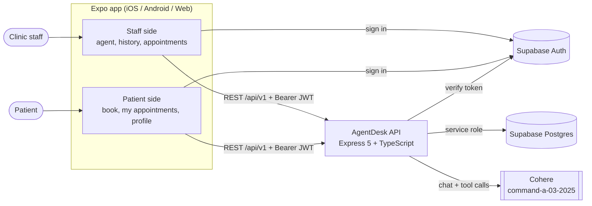
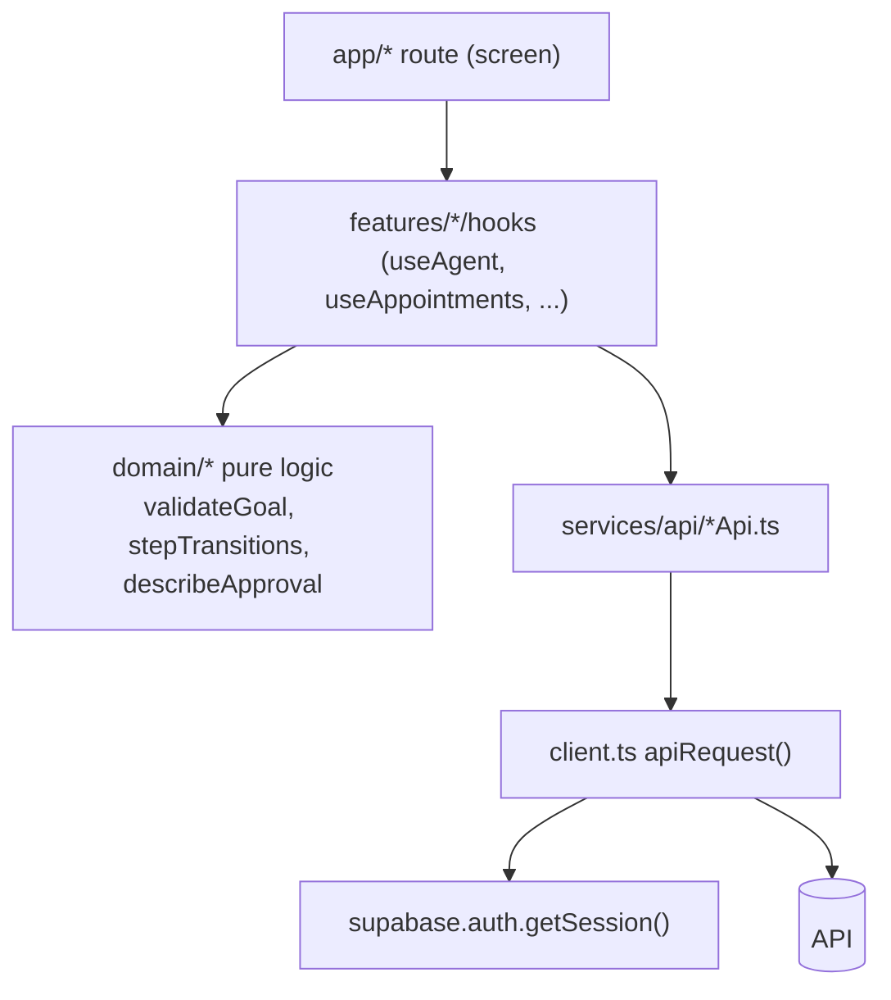
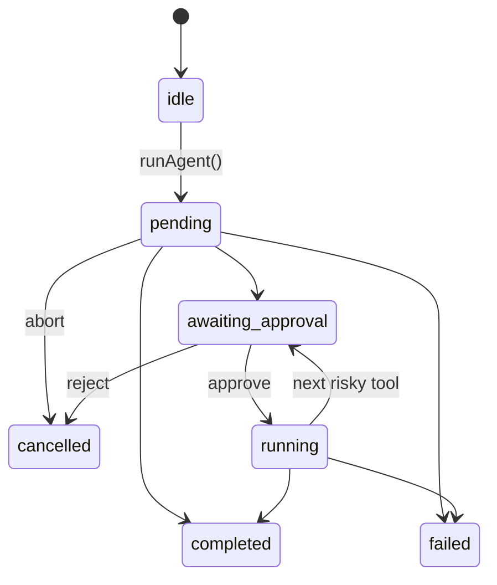
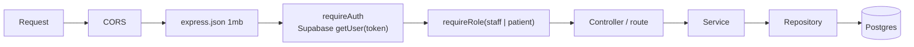
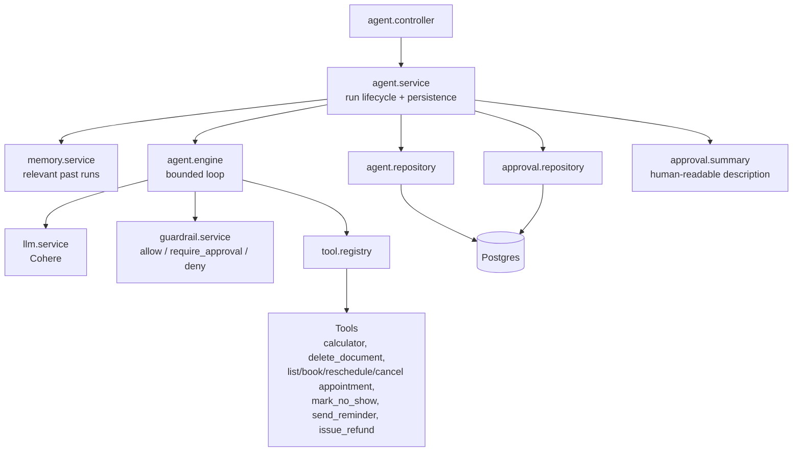
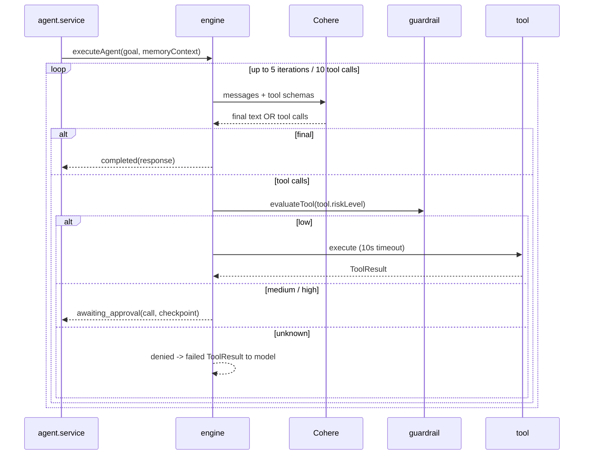
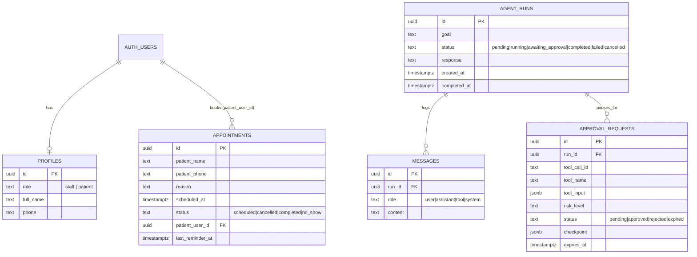

# AgentDesk Architecture (Draft v0.1)

AgentDesk is an AI front-desk assistant for a small clinic. Staff give the agent a goal in plain language ("Cancel Priya's 4pm tomorrow and remind the next patient"). The agent plans, calls tools, and pauses for human approval before doing anything risky. Patients use a separate portal to book and manage their own appointments.

This document describes the system **as it is built today**, then lists gaps, a suggested roadmap, and future scope.

The next MVP is a multi-location appointment system, specified separately and not built yet: [DATA_MODEL.md](DATA_MODEL.md) (schema, statuses, conflict rules) and [WIREFRAMES.md](WIREFRAMES.md) (patient, desk, doctor, and admin screens). Scheduling, nullable doctor assignment, and location-scoped roles come before further AI work. Sections below this note still describe the running single-clinic app.

---

## 1. System context



| Layer | Technology |
|---|---|
| Client | Expo SDK 57, React Native 0.86, React 19, `expo-router` (file-based routing), Reanimated |
| API | Node, Express 5, TypeScript, `cors`, `dotenv` |
| Auth | Supabase Auth (JWT access tokens, session persisted in AsyncStorage) |
| Database | Supabase Postgres, accessed only by the API using the service role key |
| LLM | Cohere `command-a-03-2025` via `cohere-ai` (chat v2 with tool calling) |

---

## 2. Repository layout

The client and API live in the `Frontend` and `Backend` folders of this repository.

```
Frontend/
└── src/                         # Expo client
    ├── app/                     # Routes (expo-router)
    │   ├── sign-in.tsx
    │   ├── agent/               # Staff: run the agent
    │   ├── history/             # Staff: past runs + [runId] detail
    │   ├── appointments/        # Staff: appointment list
    │   └── patient/             # Patient: index, book, appointments, profile
    ├── features/                # Feature modules (UI + hooks + domain logic)
    │   ├── auth/                # AuthProvider, session + account (role)
    │   ├── agent/               # useAgent, components, domain/ (pure logic)
    │   ├── history/  appointments/  patient/
    ├── services/
    │   ├── auth/supabase.ts     # Supabase client (anon key)
    │   └── api/                 # client.ts + agentApi / appointmentApi / patientApi
    ├── components/ui/           # Design-system primitives
    └── constants/theme.ts       # colors, spacing, fonts

Backend/
├── supabase/migrations/         # 001–005, applied manually
├── tests/                       # unit and HTTP contract tests
└── src/
    ├── app.ts  server.ts
    ├── config/                  # env, supabase, cohere
    ├── middleware/              # auth, authorization, logging, errors
    ├── routes/v1/               # HTTP paths under /api/v1
    └── modules/
        ├── ai-agent/            # engine, guardrail, Cohere, tools
        ├── appointments/        # schedule, repository, staff reads
        ├── patients/            # patient portal rules
        └── profiles/            # role and contact details
```

---

## 3. Client architecture

**Pattern:** route → feature hook → API service. Screens stay thin; state and rules live in hooks and pure `domain/` functions.



### 3.1 Auth and role-based navigation
- `AuthProvider` holds the Supabase session and the `account` (including `role`) fetched from `GET /api/v1/me`.
- `_layout.tsx` uses `Stack.Protected` guards: signed-out users see `sign-in`; `staff` see the agent/history/appointments screens; `patient` see the `patient/*` screens. If the role can't be loaded the app shows an error screen rather than guessing.
- `apiRequest` attaches `Authorization: Bearer <token>`, unwraps the `{ success, data, error }` envelope, and on `401` signs the user out locally so the guard returns them to sign-in.

### 3.2 Agent run state machine (client mirror)
`useAgent` mirrors server state into UI state:



- Stale responses are dropped using a generation counter; `AbortController` handles cancel.
- On a failed approve/reject the hook re-reads the run from the server instead of guessing the state (the approval may have expired or been resolved elsewhere).
- The four UI "steps" (understand, plan, execute, result) are a presentation device; the real execution trace is the persisted message log.

---

## 4. API architecture

### 4.1 Request pipeline



All responses use one envelope: `{ success: true, data }` or `{ success: false, error: { code, message } }`.

### 4.2 Endpoints (`/api/v1`)

| Area | Method + path | Role | Purpose |
|---|---|---|---|
| Health | `GET /health` | public | Liveness |
| Me | `GET /me` | any user | Account + role |
| Agent | `POST /agents/runs` | staff | Create and execute a run |
| | `GET /agents/runs` | staff | List runs |
| | `GET /agents/runs/:runId` | staff | Run + message log |
| | `POST /agents/runs/:runId/approve` | staff | Approve pending tool call, resume |
| | `POST /agents/runs/:runId/reject` | staff | Reject, cancel run |
| Appointments | `GET /appointments` | staff | Staff view of one clinic day |
| | `GET /appointments/:id` | staff | One appointment, same fields as the day list |
| Patient | `PUT /patient/profile` | patient | Update name and phone |
| | `GET /patient/slots` | patient | Available slots |
| | `GET /patient/appointments` | patient | My appointments |
| | `POST /patient/appointments` | patient | Book |
| | `POST /patient/appointments/:id/cancel` | patient | Cancel own appointment |

### 4.3 Authn vs authz
- **Authentication** (`requireAuth`): validates the JWT with Supabase Auth (not just decoding it), so deleted or signed-out users are rejected. Returns `503` if Supabase is unreachable rather than a misleading `401`.
- **Authorization** (`requireRole`): reads `profiles.role`. A missing profile becomes `patient`, so staff access can never be granted by accident. Role is not writable via the API; staff are promoted by an admin in SQL.

---

## 5. The agent core (most important part)

### 5.1 Design principle
> The model proposes. The backend disposes.

The LLM never executes anything. It returns *requested tool calls*; the engine decides whether each is allowed, needs approval, or is denied, and only the human can resolve an approval. There is no code path where the agent approves its own action.

### 5.2 Components



### 5.3 Execution loop (`agent.engine.ts`)



Safety limits: `MAX_ITERATIONS = 5`, `MAX_TOOL_CALLS = 10`, `TOOL_TIMEOUT_MS = 10s`. Bad tool arguments, unknown tools, timeouts and tool errors become failed `ToolResult`s fed back to the model so it can recover, rather than crashing the run.

### 5.4 Guardrails and risk levels

| Risk | Decision | Tools |
|---|---|---|
| `low` | allow | `calculator`, `list_appointments`, `book_appointment`, `reschedule_appointment`, `mark_no_show`, `send_reminder` |
| `medium` / `high` | require human approval | `cancel_appointment`, `issue_refund`, `delete_document` |
| anything else | deny (fail closed) | n/a |

`send_reminder` and `issue_refund` are currently **simulated**; the system prompt tells the model to say so honestly.

### 5.5 Human-in-the-loop (pause and resume)

1. Engine hits a risky call and returns `awaiting_approval` with a **checkpoint**: messages, pending calls, iteration and tool-call counters, memory context.
2. `agent.service` stores an `approval_requests` row (tool name, input, risk, `expires_at` = now + 10 min, checkpoint) and sets the run to `awaiting_approval`. The checkpoint is server-only and never returned by the API.
3. Staff approve or reject:
   - **Approve:** `resumeAgent(checkpoint)` runs the approved call as-is (only that `callId` bypasses the guardrail). Later calls still pass through it, and the run may pause again.
   - **Reject:** run becomes `cancelled`.
4. A partial unique index guarantees **one pending approval per run**, and stale approvals are expired.

### 5.6 Memory
`memory.service` pulls recent completed runs, scores them for relevance against the new goal, and passes a size-capped transcript (`User:` / `Assistant:`) to the model. Failure is swallowed so memory can never break a run.

---

## 6. Data model



Key constraints: unique active slot per `scheduled_at` (single-doctor clinic), one pending approval per run, `ON DELETE CASCADE` from runs to messages and approvals.

---

## 7. Security model

| Concern | Current approach |
|---|---|
| Who are you | Supabase JWT verified server-side on every request |
| What may you do | Role from `profiles`; `staff` vs `patient` route trees |
| Database exposure | RLS enabled with no policies on all tables; only the API (service role key) reads/writes. The anon key can reach nothing |
| Privilege escalation | Role not writable through API; default role is `patient` |
| Agent safety | Guardrail by risk level, approval gate, bounded loop, tool timeouts, fail-closed default |
| Approval integrity | Checkpoint stays server-side; only an authenticated staff request can resolve approval; approvals expire |
| Data minimisation | Appointments hold name, phone and reason only; no clinical data by design |

---

## 8. Known gaps and risks

1. **Migration `001` was missing.** `supabase/migrations/001_agent_runs.sql` reconstructs `agent_runs` from the columns the API uses. `CREATE TABLE IF NOT EXISTS` does not change an existing table. It has not been executed against the live database from this repository.
2. **Synchronous runs.** `POST /agents/runs` holds the HTTP request open for the whole LLM loop (up to 5 LLM calls). This risks mobile and proxy timeouts, and approve/resume has the same issue.
3. **No run ownership.** `agent_runs` has no `user_id`; any staff member sees every run, and memory is shared across all staff. Fine for a single clinic, wrong for multi-user or multi-tenant.
4. **Medium-risk actions run unattended.** `book_appointment`, `reschedule_appointment` and `send_reminder` are `low`, so the agent can change patient bookings without approval. Confirm that is intended.
5. **Approval race.** `resolveApprovalRequest` updates a row only while it is still `pending` and `expires_at` is in the future, so two staff resolving the same request cannot both win. A second tap gets a conflict.
6. **No audit log.** There is a message log, but no immutable record of who approved what, which matters once real patient data and refunds are involved.
7. **Permissive CORS** (`origin: true`) and no rate limiting on LLM-backed endpoints (cost and abuse risk).
8. **Stale build output.** `dist/` is git-ignored. `npm run start` runs compiled output, so run `npm run build` after source changes before `npm start`.
9. **Prompt injection.** Patient-supplied text (names, reasons) is read by the model via `list_appointments`. The guardrail limits blast radius, but tool inputs should be validated and treated as untrusted.
10. **Two repos in workspace.** `taskflow/` is an unrelated Expo starter; keep it out of this system's scope.

---

## 9. Suggested roadmap

Multi-location scheduling is the next MVP, not a later phase. The review drafts are [DATA_MODEL.md](DATA_MODEL.md) and [WIREFRAMES.md](WIREFRAMES.md). Implement those after Naveen reviews them: schedules and conflict checks, then patient and desk booking, then admin assignment, then doctor visit status. AI, Redis, and queues stay after that core works.

| Phase | Work |
|---|---|
| **Now** | Review and then implement the scheduling model and wireframes. Add `001_agent_runs.sql` only so the existing database stays reproducible |
| **Next** | Async runs: `POST` returns `202` with a run id, the worker executes in the background, client polls or subscribes (Supabase Realtime / SSE) for status; push notification when approval is needed |
| **Then** | Real reminder channel (SMS/WhatsApp) behind a provider interface; real refund gateway; audit table; rate limiting, structured logging and request IDs |
| **Later** | Tests (engine loop with a fake LLM, guardrail, approval races), CI, evals for agent behaviour |

---

## 10. Future scope

These are product and platform expansions beyond the current single-clinic demo. They assume the gaps in §8 are closed first, and they keep the same design principle: **the model proposes, the backend disposes**.

### 10.1 Real channels instead of simulations
`send_reminder` and `issue_refund` already have tool shapes, risk levels, and approval gates. The next step is to swap the simulated bodies for real providers behind a thin interface:
- Appointment reminders over WhatsApp or SMS (Twilio, Gupshup, or Meta Cloud API), with delivery status written back to `appointments.last_reminder_at`.
- Refunds through a payment gateway (for example Razorpay), still paused for human approval.
- Optional email confirmations for book / reschedule / cancel.

### 10.2 Stronger human-in-the-loop
- Separate **requester** (front desk) and **approver** (manager) roles so the same person cannot both run and approve a high-risk action.
- Push or in-app notification when a run is `awaiting_approval`, instead of requiring staff to stay on the agent screen.
- An immutable audit table: who requested the run, who approved or rejected which tool, at what time, with the tool input snapshot.
- Atomic approval resolution so two staff cannot resume the same run twice.

### 10.3 Asynchronous, streaming runs
- `POST /agents/runs` returns `202` with a run id; a worker executes the LLM loop in the background.
- The client polls or subscribes (Supabase Realtime or SSE) for status, tool results, and approval cards.
- Removes the mobile / proxy timeout risk of holding the HTTP request open for several LLM round-trips.

### 10.4 Richer clinic operations
Doctor schedules, leave, visit types, and bookable slots are the next MVP. See [DATA_MODEL.md](DATA_MODEL.md) and [WIREFRAMES.md](WIREFRAMES.md). Still later, after that ships:

- Rooms.
- Waitlist: when a slot is cancelled, offer it to the next waiting patient (with consent) and let the agent fill it.
- Recurring follow-up bookings.
- Staff dashboard: occupancy, incomplete-visit rate, reminder coverage — read-only analytics, not clinical data.

### 10.5 Multi-clinic tenancy
Locations, time zones, and per-location staff assignments are part of the next MVP in [DATA_MODEL.md](DATA_MODEL.md), not a later idea. Still later:

- Isolated agent memory and appointment books per location.
- Per-location tool allow-lists and risk-level overrides (one clinic may want booking behind approval; another may not).

### 10.6 Patient-facing agent (optional)
Today the agent is staff-only; patients use form screens. A later path is a constrained patient agent ("move me to Thursday afternoon") that:
- Can call only low-risk tools on **that patient's** appointments.
- Still routes cancel / refund to staff approval.
- Requires identity and consent checks before any write.

### 10.7 Quality, safety, and compliance
- Automated tests for the engine loop (fake LLM), guardrail decisions, and approval races.
- Offline evals of agent behaviour on a fixed set of clinic goals.
- Rate limiting, structured logging, and request IDs on LLM-backed endpoints.
- DPDP-oriented consent, retention, and patient data export / delete.
- Prompt-injection hardening: treat patient-supplied names and reasons as untrusted tool input.

### 10.8 Deliberately out of scope unless requirements change
- Diagnosis, prescriptions, or clinical notes. Appointments hold name, phone, and reason only, by design.
- Unattended high-risk actions. Cancel, refund, and delete stay behind a human, even after providers are real.
- Letting the model execute tools itself. The engine and guardrail remain the only path to side effects.

---

## 11. Open questions

- Single-clinic vs multi-location is decided for the next MVP: locations and time zones are in [DATA_MODEL.md](DATA_MODEL.md). Still confirm with Naveen that one doctor may hold a different weekly schedule at each location.
- Which actions should always need approval (booking? reminders?), and should approver role differ from requester (manager vs front desk)?
- Which reminder channel and refund provider will be used, and what are the consent/compliance requirements (DPDP)?
- Should the agent be able to act on patient-initiated requests, or stay staff-only?
