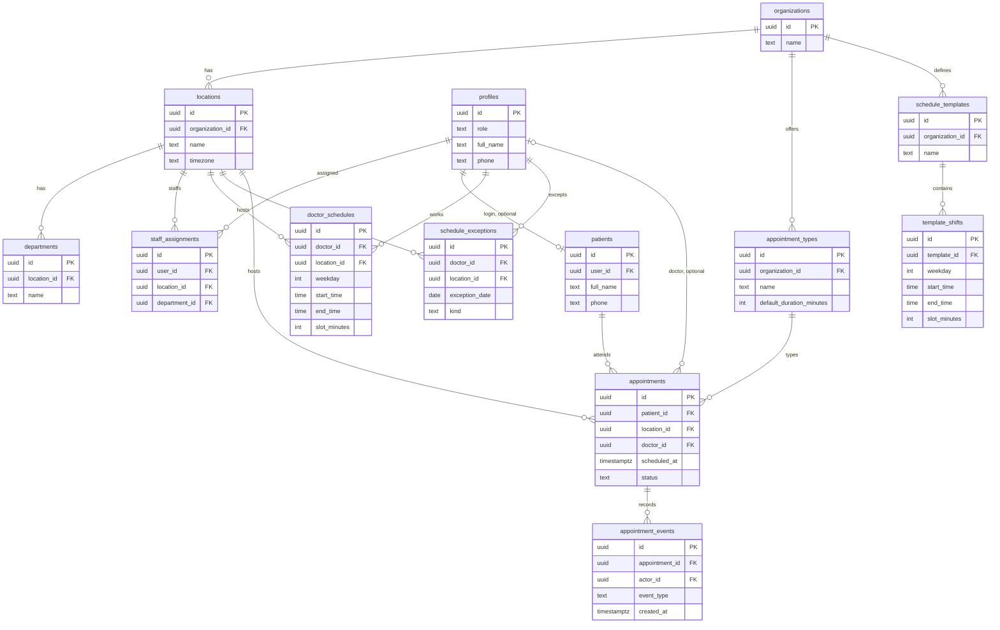
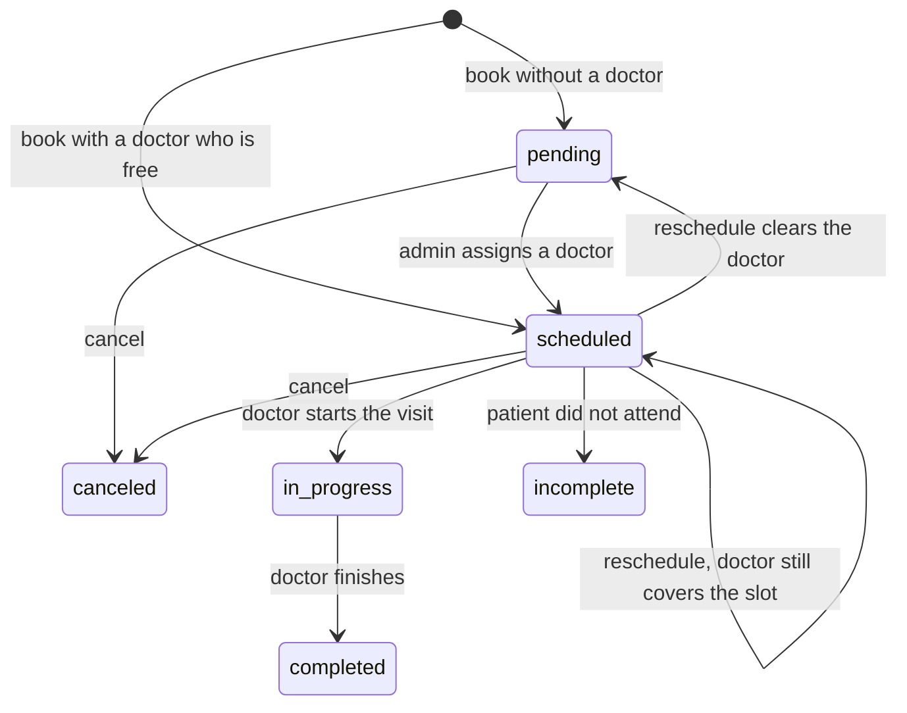

# AgentDesk data model (proposed MVP)

This document is the review draft for Naveen. It describes the schema to build next. It is not applied: there is no migration for these tables.

The system as it runs today is still the single-clinic model in [ARCHITECTURE.md](ARCHITECTURE.md) section 6. Hours are constants in `src/modules/appointments/clinicSchedule.ts` (Asia/Kolkata, 10:00–17:30, Sunday closed). `appointments.status` is `scheduled | cancelled | completed | no_show`, there is no doctor or location column, and a unique index allows only one live row per `scheduled_at`.

Screens that use this model are in [WIREFRAMES.md](WIREFRAMES.md).

## Assumption to confirm

A doctor may work at more than one location, with a separate weekly schedule at each location. One assignment row is the single-location case. A schedule always belongs to a doctor and a location. It is never a clinic-wide constant.

## Roles

`profiles.role` grows from `staff | patient` to four values. The API still does not let a client set its own role.

| Role | What they do |
|---|---|
| `patient` | Book a visit and view their own appointments |
| `staff` | Desk work at assigned locations: register a patient, book, view that location’s appointments, cancel or reschedule within desk permissions |
| `doctor` | See assigned visits and set `in_progress` or `completed` |
| `admin` | Edit schedules and leave, assign a doctor to a pending visit, reassign or reschedule when a doctor is unavailable |

`staff_assignments` connects a `staff`, `doctor`, or `admin` profile to a location and an optional department. A person may have more than one row. Patients have none.

The doctor workspace is a fourth guarded area in the same Expo app. Naveen named three dashboards and also described doctor actions; confirm that this role stays separate from desk staff.

## Entity diagram

Existing agent tables stay as they are and are out of this MVP. They are not expanded here.

The diagram below is the whole schema. Role-scoped views of the same entities, keys, and cardinality are in [ER_DIAGRAMS.md](ER_DIAGRAMS.md): patient, staff and admin, and doctor.

## Tables

### Organization

`organizations` is the tenant. `locations` are hospitals or clinic branches. `timezone` is an IANA name (`Asia/Kolkata`, `America/New_York`). `departments` belong to one location.

### People

`profiles` remains one row per Supabase Auth user. Columns stay `id`, `role`, `full_name`, `phone`, timestamps. The role check becomes `patient | staff | doctor | admin`.

`staff_assignments`: `user_id` → `profiles`, `location_id` → `locations`, `department_id` nullable → `departments`. Unique on `(user_id, location_id)`. The department, when set, must belong to that location.

`patients` holds the person the visit is for. `user_id` is unique and nullable: a self-service patient links to their profile; a walk-in registered by the desk has no login. `full_name` and `phone` are required. `date_of_birth` is optional. No clinical notes.

### Scheduling

`appointment_types` belong to an organization: `name`, `default_duration_minutes`, `active`. The patient picks a type. A doctor is optional at booking time.

`schedule_templates` are reusable weekly patterns for an organization (`name`). `template_shifts` are one row per weekday in that template: `weekday` 0–6 (Sunday–Saturday), `start_time`, `end_time`, `slot_minutes`. Unique on `(template_id, weekday)`. A closed day is the absence of a row, not a zero-length shift. `end_time` must be after `start_time`.

`doctor_schedules` is the live weekly pattern: one row per doctor, location, and weekday, with the same time columns, plus nullable `source_template_id`. Unique on `(doctor_id, location_id, weekday)`. Applying a template copies shifts into these rows for that doctor and location. Later edits to the template do not change copies already saved. The doctor must have a `staff_assignments` row for that location.

`schedule_exceptions` override one date: `doctor_id`, `location_id`, `exception_date` (a calendar date in that location), `kind` of `unavailable` or `modified_hours`, nullable `start_time` and `end_time`, nullable `note`, `created_by`. Unique on `(doctor_id, location_id, exception_date)`.

- `unavailable`: both times are null. The doctor accepts no appointments that date at that location.
- `modified_hours`: both times are required and `end_time` is after `start_time`. That window replaces the weekly row for that date only.

### Appointments

`appointments` columns:

| Column | Notes |
|---|---|
| `patient_id` | Required |
| `location_id` | Required |
| `department_id` | Optional; must belong to `location_id` |
| `appointment_type_id` | Required |
| `doctor_id` | Nullable. Null only while `pending`, and required for `scheduled`, `in_progress`, and `completed` |
| `scheduled_at` | Start, `timestamptz`, stored in UTC |
| `duration_minutes` | Copied from the type at booking time so a later type edit does not move existing visits |
| `reason` | Optional, short text |
| `status` | See below |
| `cancel_reason` | Set when status becomes `canceled` |
| `created_by` | Profile that booked it; null if that path has no user |
| `assigned_by` | Admin who set `doctor_id`; null until then |

`canceled` and `incomplete` keep whatever `doctor_id` they had, including null if a pending visit is canceled before assignment.

`appointment_events` is append-only. No updates, no deletes from the app.

| Column | Notes |
|---|---|
| `appointment_id` | Required |
| `actor_id` | Profile that performed the change |
| `event_type` | `created`, `assigned`, `status_changed`, `rescheduled`, `canceled` |
| `from_status`, `to_status` | Nullable when the field did not change |
| `from_doctor_id`, `to_doctor_id` | Nullable |
| `from_scheduled_at`, `to_scheduled_at` | Nullable |
| `note` | Optional |
| `created_at` | Set by the database |

A reschedule updates `appointments.scheduled_at` and inserts a `rescheduled` event. It does not add a `rescheduled` status. If the assigned doctor cannot cover the new time, the admin clears `doctor_id`, sets status back to `pending`, and records both the time change and the unassignment.

## Appointment status

Replace `scheduled | cancelled | completed | no_show`. The current value `cancelled` becomes `canceled`. The current value `no_show` becomes `incomplete`, and that word means only one thing: the patient did not attend. The word “done” from the meeting is `completed`.

| Status | Meaning | `doctor_id` |
|---|---|---|
| `pending` | Time and location are reserved. Doctor assignment is still open | null |
| `scheduled` | Confirmed and assigned | required |
| `in_progress` | The doctor started the visit. Manual action. No QR scan in the MVP | required |
| `completed` | The doctor marked the visit finished | required |
| `canceled` | Canceled by the patient, desk, or admin | unchanged |
| `incomplete` | The patient did not attend | unchanged |

`pending` is only “waiting for a doctor.” Do not reuse it for a waiting room or for a visit that has started.

No other transitions. `completed`, `canceled`, and `incomplete` are terminal.

Who may move status:

| Move | Who |
|---|---|
| `pending` → `scheduled` | `admin` at that location |
| `pending` or `scheduled` → `canceled` | The patient who owns it, `staff` at that location, or `admin` |
| `scheduled` → `in_progress` | The assigned `doctor` |
| `scheduled` → `incomplete` | `staff` or `admin` at that location |
| `in_progress` → `completed` | The assigned `doctor` |
| Time change, or clearing the doctor | `admin`. Desk `staff` may reschedule only when the new slot is still valid for the same doctor |

Every successful move inserts an `appointment_events` row in the same transaction as the appointment update.

## Working hours and bookable slots

Working hours and a free slot are different.

- Working hours are `doctor_schedules` for that weekday, replaced for a single date by `schedule_exceptions`.
- A slot is a window of `duration_minutes` inside those hours that passes the conflict rules below.

The server computes slots. A disabled button in the app is not the check. Create and update both run the same check before commit.

Rules:

1. Interpret the requested start in the location’s IANA timezone. Persist `scheduled_at` in UTC. Every screen shows that location’s local time.
2. The window must sit inside a doctor’s working hours at that location, after exceptions. A weekly row of Monday 08:00–17:00 does not make Monday bookable if that date is `unavailable`.
3. Two rows with the same `doctor_id` must not overlap while status is `scheduled` or `in_progress`. Enforce with a Postgres exclusion constraint on `tstzrange(scheduled_at, scheduled_at + duration_minutes)` for those statuses. `pending` rows have no doctor, so they do not occupy one. `canceled`, `incomplete`, and `completed` do not block the doctor.
4. A patient may book a time without choosing a doctor. That insert is `pending` and `doctor_id` is null. Offer the time only when at least one doctor at that location could cover it: on schedule, not excepted out, and free of an overlapping `scheduled` or `in_progress` row.
5. Pending rows at the same time are capped at the number of doctors who could cover that window. If that count is zero, the slot is not offered. The cap is checked again at confirm time so two patients cannot both take the last open seat.
6. Assigning a doctor (`pending` → `scheduled`) is allowed only when that doctor is assigned to the location, is inside working hours that day, is not on leave, and has no overlap. The exclusion constraint is the backstop if two admins assign the same doctor at once.
7. Booking a named doctor up front inserts `scheduled` with that `doctor_id` only when rule 3 passes. Otherwise the API rejects the booking. It does not silently save a `pending` row for a doctor the patient asked for by name.

Patient privacy stays as it is today: name, phone, optional date of birth, and a short reason. Do not put clinical notes on `appointments` or on `appointment_events`.

## Already built, not part of this MVP

Leave these tables unchanged in this design pass:

- `agent_runs`, `messages`, `approval_requests` (see ARCHITECTURE.md section 6)

AI runs, approval gates, Redis, and queues wait until booking, assignment, and visit status work without them.

## What implementation will replace

When this model is migrated later:

- Stop using the constants in `clinicSchedule.ts` as the source of hours. Slot generation reads `doctor_schedules` and `schedule_exceptions`.
- Drop the unique index on `appointments(scheduled_at) where status = 'scheduled'`. Overlap is per doctor and time range, and unassigned pending rows share a time up to the doctor count.
- Map stored `cancelled` to `canceled` and `no_show` to `incomplete` if any rows exist.
- Add `doctor` and `admin` to the role check. Existing `staff` and `patient` rows stay valid.
