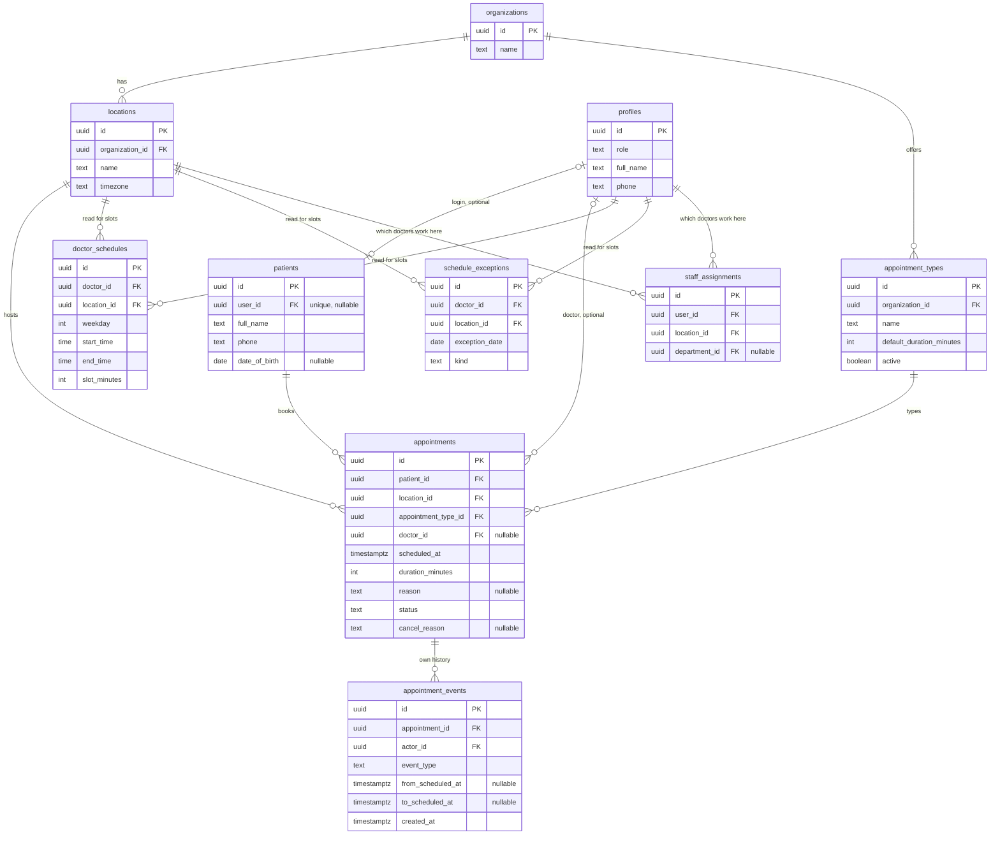
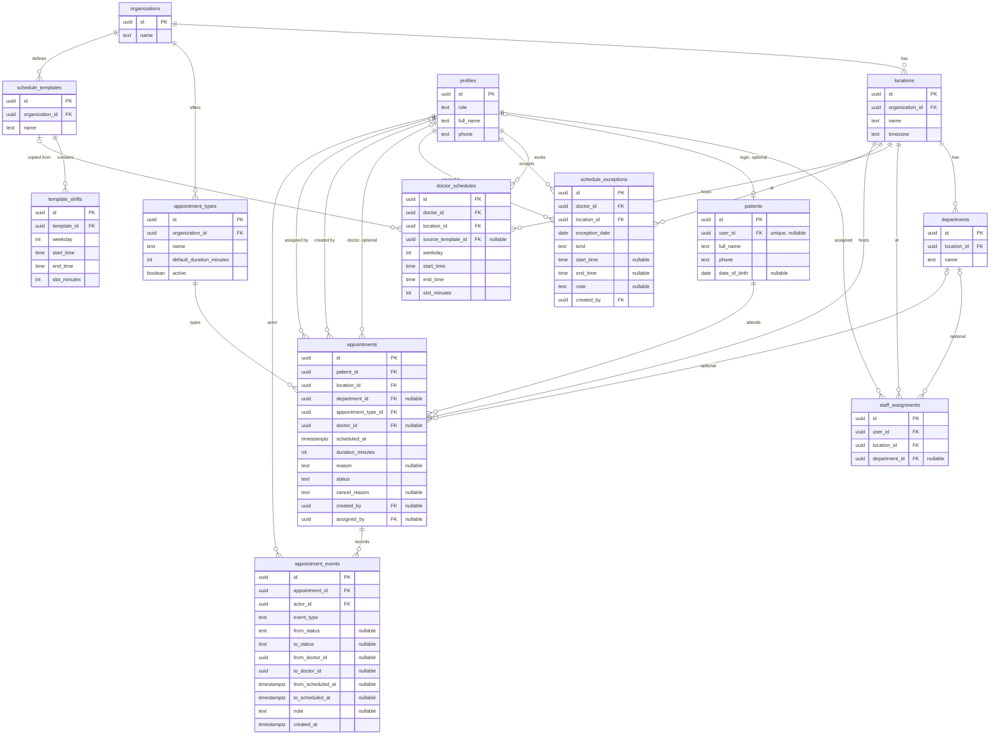
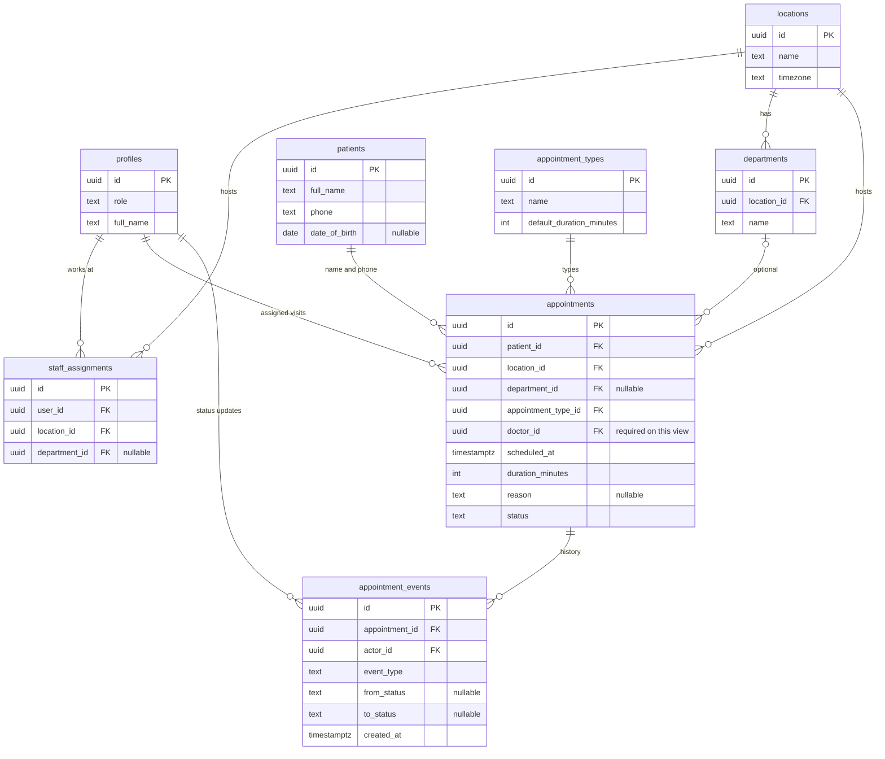

# AgentDesk ER diagrams by role

Review diagrams for the appointment MVP. They are three views of one database, using the entities, keys, and status rules in [DATA_MODEL.md](DATA_MODEL.md). Screens that read these tables are in [WIREFRAMES.md](WIREFRAMES.md).

No new tables. Agent tables (`agent_runs`, `messages`, `approval_requests`) stay out of this pass.

## Confirm with Naveen

A doctor may work at more than one location. In this model that is many `staff_assignments` rows and many `doctor_schedules` rows, one weekly pattern per location. One assignment row is the single-location case. A schedule always belongs to one doctor and one location.

If Naveen decides a doctor belongs to exactly one location, both of those relationships become one location per doctor. The rest of the diagram stays as drawn.

## Shared rules

These rules are the same on every diagram.

| Status | Meaning | `doctor_id` |
|---|---|---|
| `pending` | Time and location are reserved. Doctor assignment is still open | null |
| `scheduled` | Confirmed and assigned | required |
| `in_progress` | The assigned doctor started the visit | required |
| `completed` | The assigned doctor finished the visit | required |
| `canceled` | Canceled by the patient, desk, or admin | unchanged, including null |
| `incomplete` | The patient did not attend | unchanged, including null |

`pending` means waiting for a doctor. `incomplete` means the patient did not attend. `completed`, `canceled`, and `incomplete` are terminal. A reschedule changes `scheduled_at` and writes an event. It does not add a status.

`doctor_id` is a nullable foreign key to `profiles`. It is null only while the visit is `pending`, and it stays null if that pending visit is `canceled` before anyone assigns a doctor. `scheduled`, `in_progress`, and `completed` require it.

Primary keys are `uuid`. `scheduled_at` is `timestamptz` in UTC. Every screen shows the location’s local time (`locations.timezone`).

Uniqueness:

| Table | Unique key |
|---|---|
| `staff_assignments` | `(user_id, location_id)` |
| `patients.user_id` | unique, and nullable for a walk-in |
| `template_shifts` | `(template_id, weekday)` |
| `doctor_schedules` | `(doctor_id, location_id, weekday)` |
| `schedule_exceptions` | `(doctor_id, location_id, exception_date)` |

A doctor who is `scheduled` or `in_progress` cannot overlap another visit. That is a Postgres exclusion constraint on the time range, per `doctor_id`. `pending` rows have no doctor, so they do not occupy one. They are capped at the number of doctors who could cover that window.

`appointment_events` is append-only.

## Patient

The patient books and reviews their own visits: location, appointment type, date, and slot, then the list of visits they already have. They read schedules to see open slots. They do not edit hours, leave, or doctor assignment.

A self-service patient has `patients.user_id` set to their `profiles` row. The column stays nullable because the desk can register a walk-in with no login.

`profiles |o--o| patients` is zero-or-one in both directions. A booking from the patient app always sets `user_id`. A walk-in leaves it null, and that row is created on the staff diagram. A doctor or desk profile has no `patients` row.

| Relationship | Cardinality | On this flow |
|---|---|---|
| Organization to locations | one to many | Patient picks one branch |
| Organization to appointment types | one to many | Patient picks one type |
| Patient to appointments | one to many | Patient sees only their rows |
| Location to appointments | one to many | Required on every booking |
| Type to appointments | one to many | Required. Duration is copied onto the visit |
| Doctor to appointments | zero-or-one to many | Empty means `pending`. A named free doctor means `scheduled` |
| Doctor to schedules and exceptions | one to many, per location | Read-only. A slot is shown when at least one assigned doctor can cover it |
| Appointment to events | one to many | Read-only, so a moved time can be explained |

The patient writes `appointments` (book, and cancel when status is `pending` or `scheduled`) and the matching `appointment_events` row. They may update their own `patients.full_name` and `phone`. Cancel sets `canceled` and `cancel_reason`.

## Staff and admin

Desk staff and admins share this schema and differ by what they may write. Both are limited to locations on their `staff_assignments` rows. A person may hold more than one location. Patients have no assignment row.

Desk staff register a walk-in, book into the location they have selected, cancel, mark `incomplete`, and reschedule a `scheduled` visit only onto a slot the same doctor can still cover.

Admins edit weekly hours, templates, and leave; assign a doctor to a `pending` visit; and reassign or reschedule when that doctor cannot keep the slot.

A `doctor_schedules` row exists only when that doctor already has a `staff_assignments` row for the same location. The department on an appointment, when set, belongs to that appointment’s location. Applying a template copies `template_shifts` into `doctor_schedules` for one doctor and one location. Later edits to the template leave those copies unchanged.

| Relationship | Cardinality | Who writes it |
|---|---|---|
| Profile to staff assignments | one to many locations | Admin. Unique per person and location |
| Doctor to weekly schedules | one to many, per location and weekday | Admin. Desk reads this to offer slots |
| Template to shifts | one to many, one row per open weekday | Admin. A closed day is a missing row |
| Doctor to exceptions | one per location per date | Admin. `unavailable` or `modified_hours` |
| Patient to profile | zero or one | Desk creates a walk-in with `user_id` null |
| Patient to appointments | one to many | Desk books, cancels, marks `incomplete`, reschedules on the same doctor |
| Doctor to appointments | zero-or-one to many | Admin fills `doctor_id` to move `pending` to `scheduled`, or clears it back to `pending` |
| Appointment to events | one to many | Every successful change, same transaction |

Desk reschedule keeps `doctor_id` and status `scheduled`. Admin reschedule may keep the doctor, or clear `doctor_id` and set `pending` when the new time has no covering doctor. Both write a `rescheduled` event.

## Doctor

The doctor sees visits already assigned to them and updates the visit. Pending rows stay off this list because `doctor_id` is null. Weekly hours and leave stay on the admin side of the staff diagram. A doctor who works at more than one location switches location; each location is a `staff_assignments` row.

Authorized patient fields on a visit are name, phone, optional date of birth, and the short reason. There are no clinical notes on `appointments` or `appointment_events`.

On this view `profiles ||--o{ appointments` is required because every row the doctor can open has `doctor_id` set to that doctor. The column is still nullable in the table for `pending` visits, which this role does not see.

| Relationship | Cardinality | On this flow |
|---|---|---|
| Doctor to locations | one to many assignments | Switcher when they work at more than one branch |
| Doctor to appointments | one to many | Only `scheduled`, `in_progress`, and `completed` rows assigned to them |
| Patient to appointments | one to many | Identity and contact only |
| Appointment to events | one to many | Doctor reads assignment and reschedule history, and appends their own status change |

The assigned doctor writes two moves: `scheduled` to `in_progress`, and `in_progress` to `completed`. Each move inserts an `appointment_events` row with `event_type` `status_changed`. Cancel, `incomplete`, reassignment, and schedule edits are on the staff and admin side.
