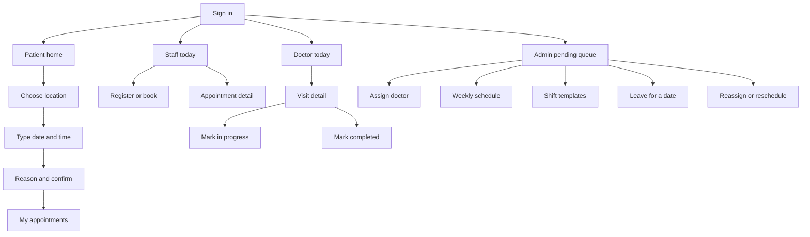

# AgentDesk wireframes (proposed MVP)

Screen-level flows for review with Naveen. These are layout and action notes, not visual mockups, and they are not built yet. Status names and booking rules match [DATA_MODEL.md](DATA_MODEL.md).

The app today is two roles. Patients book a date and a slot with a reason on `src/app/patient/book.tsx`, with hours hardcoded for one clinic. Staff see a single appointment list on `src/app/appointments/index.tsx`. There is no location picker, no appointment type, no doctor, and no admin schedule screens.

The doctor area below is a fourth guarded role in the same Expo app, not a separate product. Naveen described three dashboards (desk, patient, admin) and also described doctor actions. Confirm that doctors keep this separate workspace.

Times on every screen are the location’s local time. The server stores UTC.

## MVP map

## Patient

Patients only see their own visits. They never see another patient’s name, and they never edit a doctor’s schedule.

### Home — MVP

Replaces the current “My Care” landing.

- Greeting and the next visit, if one exists: location, local date and time, type, status, doctor name or “Waiting for a doctor.”
- Primary action: Book a visit.
- Secondary: My appointments, My details (name and phone, already on `patient/profile`).

Empty state: no upcoming visit, with the same Book action.

### Book — choose location — MVP

New. The current book screen skips this because there is only one clinic.

- List of locations the organization offers: name only.
- One location is selected. Continue.

If the patient already has a location from a previous booking, that row is preselected and they can change it.

### Book — type, date, and time — MVP

Replaces the current day strip and slot grid, which assumes one clinic calendar.

- Appointment type (name and duration). Changing the type reloads slots.
- Date strip inside the booking window.
- Slot list for that date. Each slot is a local start time. A slot appears only when the server says at least one doctor at that location could cover it.
- Optional doctor. Default is “Any available doctor.” Choosing a named doctor filters the grid to that doctor’s free slots. If they have none that day, the list says so and offers “Any available doctor.”
- The patient is not asked to pick a doctor.

A time with no covering doctor is absent from the list. The screen does not offer it and then fail.

### Book — reason and confirm — MVP

- Short reason, optional, same length limit as today.
- Summary: location, type, local date and time, doctor or “A doctor will be assigned.”
- Confirm calls the server again. If the slot was taken between the list and the tap, the screen returns to the slot step with that time removed and a short message.
- Success: “Pending” when no doctor was chosen, or “Scheduled” with the doctor’s name when one was. Then My appointments.

### My appointments — MVP

Replaces `patient/appointments`.

- Upcoming first, then past.
- Each row: local date and time, location, type, status, doctor name or “Waiting for a doctor.”
- Status labels: Pending, Scheduled, In progress, Completed, Canceled, Incomplete.
- Open a row for detail: the same facts, cancel reason when canceled, and a note when the time or doctor changed (“Moved from Tue 9:00 to Tue 11:00”).
- Cancel is available for Pending and Scheduled. Confirm before the call. In progress, Completed, Canceled, and Incomplete have no cancel button.

The patient cannot assign a doctor, mark incomplete, or mark the visit complete.

## Staff (desk)

Staff see appointments only for locations on their assignment. They do not edit weekly schedules or leave. Those stay on the admin screens.

### Today — MVP

Replaces `appointments/index.tsx`, which is one clinic-wide list with no location and no doctor.

- Location switcher when the person is assigned to more than one. One location at a time.
- Date, default today.
- Rows: local time, patient name, type, status, doctor or “Unassigned.”
- Filters: All, Pending, Scheduled, In progress.
- Counts for the day: pending, scheduled, incomplete.
- Primary action: Register or book.
- Tap a row: appointment detail.

Empty state: no visits that day, with the book action still available.

### Register or book — MVP

Desk books for a patient who may not have an account.

- Find a patient by name or phone. If none matches, enter name and phone and create a walk-in patient (no login).
- Then the same location (locked to the desk’s selected location), type, date, time, optional doctor, and reason as the patient flow.
- Confirm uses the same server check. Result status is Pending or Scheduled, same rule as the patient confirm screen.

### Appointment detail — MVP

- Patient name and phone, location, type, local time, duration, reason, status, doctor or “Unassigned.”
- History list from appointment events: created, assigned, rescheduled, canceled, status changes, with who and when. Newest first.
- Cancel for Pending or Scheduled, with a reason.
- Reschedule for Scheduled only, and only to a slot that doctor can still cover. The doctor stays assigned. If the visit is Pending, the desk does not reschedule it; an admin does.
- Staff do not see In progress or Completed actions. Those are on the doctor screen.
- Staff may mark a Scheduled visit Incomplete after the slot has started and the patient has not arrived.

## Doctor

Confirm with Naveen that this is its own role, not a mode inside the desk app.

Doctors do not edit their weekly hours in the MVP. If they are unavailable, they ask an admin to mark leave or change the day. That matches the meeting: the doctor calls the manager, and the manager updates the schedule.

### Today — MVP

- Visits assigned to this doctor, for the selected location if they work at more than one.
- Date, default today.
- Rows: local time, patient name, type, status.
- Pending visits are absent. They have no doctor yet.
- Tap a row: visit detail.

Empty state: no assigned visits.

### Visit detail — MVP

- Patient name and phone, reason, type, location, local time, status.
- History of assignment and reschedule for this visit, same event list as the desk, without other doctors’ schedules.
- If status is Scheduled: one primary action, In progress.
- If status is In progress: one primary action, Completed.
- No other status buttons. The doctor does not cancel, mark incomplete, or reassign.

There is no QR scan. Starting the visit is the In progress button.

## Admin

Admins act only at locations they are assigned to. They see doctors, schedules, and appointments for those locations. They do not see clinical notes. The appointment still holds name, phone, and reason only.

### Pending queue — MVP

Home for this role.

- Location switcher, same rule as the desk.
- List of Pending visits: patient, type, local time, location.
- Filters for Scheduled and for a chosen doctor, so a day can be reviewed after assignment.
- Tap a pending row: assign.
- Secondary entry points: Schedules, Templates, Leave.

Empty state: no visits waiting for a doctor.

### Assign a doctor — MVP

- The visit summary stays pinned: patient, type, location, local time, duration.
- List titled “Available for this time.” Each row is a doctor who is assigned to that location, inside working hours, not on leave, and free of an overlapping scheduled or in-progress visit.
- One doctor, then Assign. Success returns to the queue and the visit is Scheduled.
- If the list is empty, say why in one line: no one is scheduled then, or everyone on the schedule is already booked. Actions offered: Reschedule this visit, or Mark a doctor’s leave if the admin needs to fix the day first.
- Two admins assigning the last free doctor: the server rejects the second save. The screen reloads the available list.

### Weekly schedule — MVP

Per doctor and location. This is the live pattern patients book against, not the template library.

- Pick a doctor who has an assignment at the selected location.
- Seven weekdays. A day is Off, or a start, end, and slot length.
- Optional: “Apply a template,” which copies that template onto this doctor and location and still lets the admin edit before saving.
- Save replaces that doctor’s rows for this location. It does not change other locations or other doctors.
- A short note under the form: existing booked visits are not moved by this save. If a change would leave a Scheduled visit outside the new hours, the save is rejected and those visits are listed so the admin can reschedule them first.

### Shift templates — MVP

Reusable patterns. Applying one does not by itself change a doctor until Weekly schedule saves the copy.

- List of templates for the organization: name, and a one-line summary such as “Mon–Fri 08:00–17:00.”
- Create or edit: name, then the same seven weekdays as the weekly schedule.
- Delete is refused when the template is only a historical source. Removing it does not wipe doctor rows already copied.

### Leave for a date — MVP

One doctor, one location, one calendar date.

- Kind: Unavailable all day, or Modified hours with a start and end.
- Optional note (“Surgery”).
- Save. That date no longer offers this doctor.
- If Scheduled visits already sit on that date, the save is refused until the admin reschedules or reassigns them. The screen lists those visits and links to each one.

### Reassign or reschedule — MVP

Opened from a visit that can no longer keep its doctor (leave, emergency, or a failed schedule save).

- Current doctor, local time, patient, type.
- Choose a new time in the same location. The slot list uses the same server rules as booking.
- Choose a doctor who can cover the new time, or leave the doctor empty.
- Save with a doctor: status stays or becomes Scheduled, and a rescheduled event stores the old time.
- Save without a doctor: status becomes Pending, the doctor is cleared, and the visit shows up on the pending queue.

Desk staff do not get this screen. They can only move a Scheduled visit along the same doctor’s free slots.

## Later — not in this MVP

Show these as out of scope on any review with Naveen. Do not add them to the flows above.

| Item | Where it lives today | Why it waits |
|---|---|---|
| Agent chat and tool steps | `src/app/agent` | Core booking and assignment come first |
| Run history and approval cards | `src/app/history` | Same. Approval stays in the product later, for sensitive changes, after visits work without the agent |
| QR check-in | Not built | In progress is a button on the doctor visit |
| Medical report summaries | Not built | Appointments stay name, phone, and reason |
| Reminders and refunds | Agent tools only, simulated | After the schedule is real |
| Redis, queues, extra databases | Not used | Postgres is enough for this training MVP |

The current agent and history routes can stay in the codebase. They are not part of this design pass and they are not on the patient, desk, doctor, or admin maps above.
